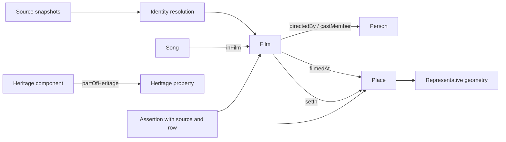

# Combining the Good Will Mapping datasets

Contribution prepared for Satyendhran's mid evaluation on 14 October 2026.
The revised task is integration-method research and a working merge of the
existing data. The heritage export was already supplied by the team.

## Recommendation and alternatives

Use an offline extract-transform-load pipeline, conservative entity resolution,
normalized tables, and an RDF projection. Keep the source snapshots intact and
record the original file and logical CSV row for every relationship. This is our
design choice for these files, rather than a finding that one method always wins.

| Approach | What it does well | Difficulty with these inputs | Decision |
|---|---|---|---|
| Concatenate all CSVs | Quick collection of similarly shaped records | Schemas differ; duplicate films and relation meanings remain unresolved | Use only inside a single source adapter |
| One wide title-based join | Familiar spreadsheet view | Remakes, title variants, and several songs/actors/places per film cause incorrect joins and row multiplication | Reject as the main model |
| Fuzzy matching / embeddings | Suggests candidates despite spelling variation | Needs labelled examples, calibrated thresholds, and manual review; cannot establish filming evidence | Future candidate generation only |
| ID joins plus guarded title/year matching | Auditable, reproducible identities and manageable source coverage | Some unresolved duplicates remain deliberately separate | Implemented now |
| RDF / GeoSPARQL after identity resolution | Typed relationships, provenance queries, geographic interoperability | Requires correct identities and coordinates first | RDF implemented; geographic store deployment is future work |

The table design follows the separation of rows, columns, values, and metadata
described by the [W3C tabular-data model](https://www.w3.org/TR/tabular-data-model/).
The current CSVs are application-specific tables, not a claim of complete CSVW
conformance.

## Inputs and source adapters

| Source files | Interpretation |
|---|---|
| `tmdb_movies.csv`, `tmdb_cast.csv`, `tmdb_directors.csv` | Movie IDs/metadata and person-ID-based credits. The supplied collector requests Hindi originals. Production country is metadata, not a shooting location. |
| `wikidata_movies.csv`, `bollywood_films_1970_2000.csv` | Wikidata film identities, filming and narrative relationships. Parse pipe-separated values only where the source format defines them. |
| `bf_2K-25.csv` | Wikipedia/DBpedia metadata, Wikipedia page identities, title/year candidates. Free-text location columns remain source attributes rather than automatically becoming geographic facts. |
| `movies_with_locations.csv`, `wikidata_cache.json` | Film identifiers and cached geographic labels. Prefer the cache's original labels over display strings such as `Mumbai (India)`. If the cache is absent, these formatted fields remain attributes and a missing-source issue is reported. |
| `enriched/films_enriched.csv`, `enriched/places.csv`, `enriched/location_assertions.csv` | Reuse the existing team's IDs, coordinates and assertion status. Only `source_supported` filming/narrative assertions enter the main graph. |
| `filmapia_film_locations.csv` | Split `|` into separate locations, then preserve each `--` hierarchy as evidence. The existing export does not retain original per-film URLs or retrieval dates; do not invent them. |
| `songs_2000_2004.csv`, `songs_2005_2009.csv` | Songs linked to films. The `wikidata_id` here identifies the film, not the song. A film location does not become a song location. |
| `bollywood_songs_1970_2026.csv` | Its standalone song records have no validated film join in this adapter; in-period records are reported for mapping review. |
| `whc001.csv` | Existing UNESCO property and component names, IDs and coordinates. Descriptions/photos are not needed for the geographic projection. |

Every source input receives a SHA-256 hash and record count in `summary.json`.
CSV row numbers are logical records with the header at row 1; a quoted field
containing line breaks can occupy several physical text lines.

## Film identity resolution

1. Load all movie records before applying the evaluation's 2000–2025 filter.
2. Connect records sharing a valid Wikidata, IMDb, TMDB, Filmapia, or exact English
   Wikipedia page identity. Keep the identifier namespaces distinct.
3. Refuse any merge that would put different IDs from one namespace into a single
   entity, including through a chain of otherwise plausible links. Record the
   conflict for review. Different Wikipedia page titles may be redirects; this
   offline pipeline keeps such conflicting pages separate until checked.
4. For remaining candidates, compare a normalized Unicode title and an exact
   year. Keep combining marks used by Indian scripts. Merge only when each
   source contributes one candidate entity and all strong IDs are compatible.
   Do not perform transliteration or fuzzy matching automatically.
5. Select the earliest observed movie release year for the canonical cohort.
   Retain every observed year and flag disagreements. This is a reproducible
   corpus rule, not independent verification of a release date.
6. Emit a source-to-canonical `film_crosswalk.csv`, including outside-period
   records. Canonical IDs are deterministic hashes of resolved identity sets.
   Rebuilding unchanged inputs yields identical IDs; adding a new external ID
   can change a hash, so preserve crosswalks when versioning future releases.

Ambiguous IDs and title/year candidates remain separate. This favours fewer false
merges at the cost of some duplicates. These are resolved entities in the supplied
corpus, not a verified census of all Bollywood releases.

## Normalized model

`film_attributes.csv` preserves nonempty source values, including differing
metadata and original location text, alongside their source rows. This avoids
silently choosing one director name, cast string, spelling, or abstract over
another. Metadata tables can be analysed without multiplying movie rows by
every combination of actor, song, and location.

`claims.csv` represents film-location, movie-credit and song-film edges. Several
sources can support the same edge. Deduplicate direct RDF triples, retain each
source assertion separately, and keep source revision/retrieval fields when
the existing inputs provide them. Unknown original retrieval dates stay unknown.

The RDF export uses subject–predicate–object triples from
[RDF 1.1](https://www.w3.org/TR/rdf11-concepts/) and `prov:wasDerivedFrom` from
[PROV-O](https://www.w3.org/TR/prov-o/). RDF reification records the provenance of
each materialized relationship. The `gwm` namespace is a project vocabulary used
by this prototype; no public namespace registration is claimed.

## Heritage and coordinates

The default uses movies from 2000 through 2025 inclusive and heritage inscriptions
through 2025. `--heritage-cutoff 2026` includes newer designations. The default
does not claim that every selected site was already inscribed when a movie was
released; add a movie-year/inscription-year comparison for that separate question.

Preserve serial properties and their individual components as different entities.
For example, the Hill Forts of Rajasthan property and Amber Fort component must
not share a single representative point. Components reference their parent.

UNESCO `Coordinates` is **latitude, longitude**. Wikidata WKT is **longitude
latitude**. GeoJSON and CRS84 WKT both use **longitude, latitude**. Missing values,
non-finite numbers, non-Earth coordinates and out-of-range values are not mapped.
The supplied component strings are parsed explicitly, and component counts are
checked against the source rather than silently dropping unparsed components.

Link a Filmapia location to a heritage identity only on an exact normalized
property/component label and compatible country from the hierarchy. Do not
assign heritage identity or coordinates to a city merely because it contains a
site. Unmatched hierarchy paths get separate place IDs and stay ungeocoded.
Cross-source place aliases, such as `Amer/Amber Fort`, are future reviewed
crosswalks, rather than automatic guesses.

The geometry representation uses [OGC GeoSPARQL](https://www.ogc.org/standards/geosparql/).
The Python distance demo computes great-circle distance on a spherical Earth with
mean radius 6,371.0088 km. It reports proximity between representative points;
it does not measure a protected boundary or verify an exact camera/shooting spot.
By default it considers filming assertions linked to identified heritage sites
or components. `--include-broad-places` also produces city/country-point candidates
for review and should not be presented as precise site-level filming evidence.

## Validation and limits

The standard-library build validates IDs, edge references, provenance presence,
coordinate ranges, and deterministic fixture rebuilds. Regression tests cover
conflicting ID chains, same-name films, Unicode labels, axis order, incorrect song
years, review-only claims and inherited song locations.

The optional validator parses the complete Turtle export, checks
[SHACL](https://www.w3.org/TR/shacl/) constraints, reconciles RDF entity/assertion
counts with CSV outputs, and executes the supplied basic SPARQL query. SHACL checks
structure and datatypes; it does not prove the historical truth of source claims.
The GeoSPARQL distance query requires a compatible store and has not been executed
by RDFLib. The offline Python distance query is the executed spatial demonstration.

The supplied snapshots contain missing location data, broad place coordinates,
some conflicting years/IDs, editorial assertions and incomplete provenance.
Review lists remain part of the contribution. No LLM completion or coordinate
guessing fills these gaps. Source licence/attribution requirements still apply
when redistributing original source content.
