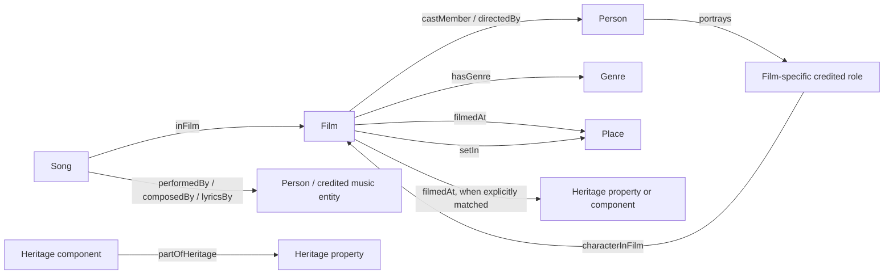

# Bollywood place-name knowledge graph

The working graph is `Dataset/integrated/graph.ttl`. Open
`Dataset/integrated/graph_explorer.html` in a browser for a searchable view.
The HTML includes its data and works offline. CSV downloads require the adjacent
files to remain in the same directory. The explorer shows a limited neighbourhood
of a selected film; the RDF and CSVs contain all accepted relationships.

## What was built

The 1970–2025 build contains 9,509 resolved movie entities, 10,708 song entities,
33,524 person/credit entities, 44,416 film-specific credited roles, 19 genres,
and 8,579 place entities. There are 211,297 distinct sourced relationships backed
by 218,993 source assertions. In addition, 5,645 UNESCO component-to-property
relationships are exported from the heritage catalogue.

The movie cohort is the union of the supplied datasets, including TMDB, rather
than just the 6,069-row enriched CSV. The inputs include shorts, documentaries,
and potentially non-Bollywood records; this is an integration of the supplied
corpus, not a newly verified census. Source conflicts are preserved for review.
People identified only by song-credit names remain scoped to a film and source:
the person count is therefore not a count of unique real-world individuals.



The problem statement's chain is a set of entity types, not a requirement that
every film have every edge. Playback singing does not prove on-screen appearance.
A film's locations do not prove that a particular song was shot there. A role is
not assigned a residence from a film's story setting. Heritage is a subtype of
place, and proximity alone does not establish filming at a heritage site.

`Event` and `Landscape` are reserved ontology classes without instances. To add
them, collect a film or scene identifier, event/landscape type, place identifier,
source URL and evidence (ideally a scene timestamp). Descriptions mentioning a
festival, a mountain or a forest are not automatically validated scene evidence.

## How the datasets were connected

1. Resolve films by compatible Wikidata, IMDb, TMDB and Wikipedia identities.
   Use unique title/year matches only when compatible; retain conflicts.
2. Preserve a crosswalk from source file and row to every canonical film.
3. Import supported filming/story-setting assertions. Keep automatic candidates
   outside the accepted graph. Import Filmapia locations as snapshot evidence.
4. Join cast/director rows using TMDB film IDs. Give characters film-and-actor
   scoped IDs; preserve compound role names and self appearances verbatim.
5. Read all five `songs_*.csv` batches. Check film identity and release year.
   Reject numeric duration/header titles and rows without track credits or a
   valid track duration. This routes 2,659 suspicious rows into `issues.csv`.
   Another 335 rows have unresolved identities or inconsistent film years.
   This is a structural quality filter, not manual verification of every song.
6. Add TMDB genre nodes. Do not parse the corrupted `bf_2K-25.csv` genre strings
   into genre facts. Preserve original values in source attributes.
7. Load UNESCO properties and components, retaining their distinct geometries.
   Exact compatible site matches can link a film location to a heritage entity.
8. Export RDF, normalized tables, GeoJSON, query results and the offline viewer.
   Preserve source rows, evidence, URLs and input hashes for auditability.

## Queries already run

`romance_places.csv` counts distinct Romance-tagged films by place and relation.
It answers a genre association question, not a scene-level emotion question.
For example, the current graph associates Mumbai with 175 Romance-tagged films
through filming and with 129 through narrative settings. Place aliases have not
all been reconciled, so these counts are entity-based rather than a definitive
ranking of consolidated geographic regions.

`heritage_genres.csv` groups filming links by UNESCO property, including linked
components. The current exact matches yield three properties: Hill Forts of
Rajasthan (3 films / 4 genres), Agra Fort (1 film / 3 genres), and Petra
(1 film / 2 genres). A single film may have several genres. The remaining UNESCO
catalogue entries have no accepted cinematic connection in this build.

Equivalent SPARQL queries are in `Queries/knowledge_graph_queries/`:
`romance.sparql`, `heritage.sparql`, and `characters.sparql`.

## Rebuild and check

From the repository root:

```sh
python Queries/build_integrated_graph.py --start-year 1970 --end-year 2025
python Queries/build_graph_explorer.py
python -m unittest discover -s Queries -p 'test_integration.py' -v
python Queries/verify_cinema_graph.py
```

The build/explorer use Python's standard library. The last verification command
and RDF-specific test use `rdflib`. The verifier parses the direct RDF graph and
every thousandth provenance record, reconciles entity and assertion counts,
executes three SPARQL queries and compares the two aggregate queries with CSV
results. It does not claim full provenance syntax or SHACL validation.
Optional SHACL validation remains in `validate_integrated_graph.py` and requires
the additional packages listed in `requirements-integration.txt`.

The integration command defaults to 1970–2025. Use --start-year 2000 to reproduce
the prior mid-evaluation demo. Always pass `--start-year 1970` to reproduce this
build. Existing QGIS files and committed demo snapshots are not automatically
refreshed; they describe the earlier integration, not this graph's new counts.
Generated `Dataset/integrated/` files are ignored by Git and can be rebuilt.

## Remaining limits

1,718 films have accepted filming locations and 1,608 have narrative locations.
Many locations are broad city/region/country points. No precise shooting
coordinate is inferred from them. Heritage inscription dates do not prove that
a site held that designation at the time a film was made.

No foundation model inferred missing facts. Foundation models could assist
future evidence extraction, but those suggestions should be reviewed before
entering the accepted graph. Existing snapshot assertions still inherit source
errors, missing provenance and imperfect geographic identity resolution.

## Executed refreshed delivery

The full snapshot and hash manifest are in `Dataset/knowledge_graph/`.
Full RDF/SHACL validation passed for 2,706,799 triples. Aggregate RDF queries
match their CSV exports. Heritage aggregation includes films without genre
metadata in film totals: nine linked properties and 25 film/property pairs;
eight properties have at least two known genres.
