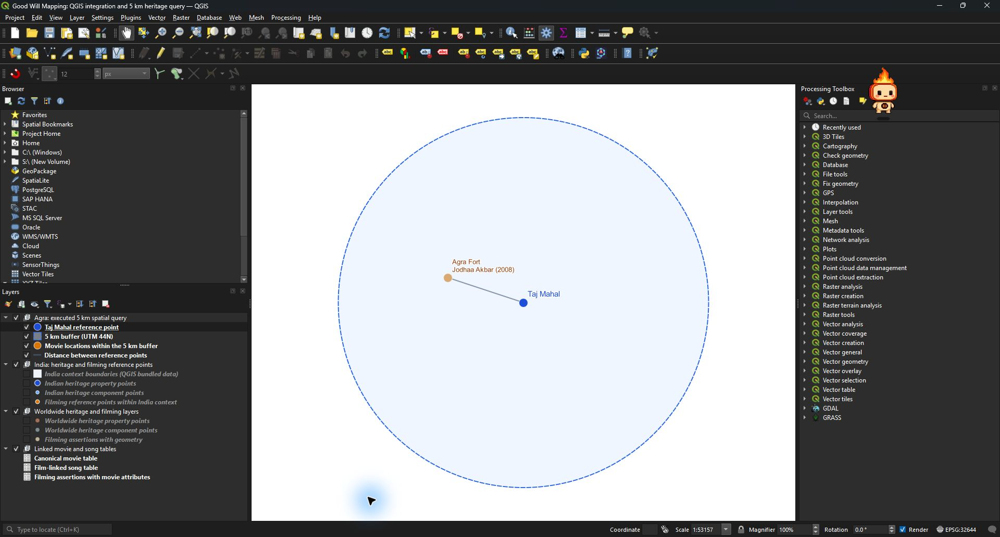
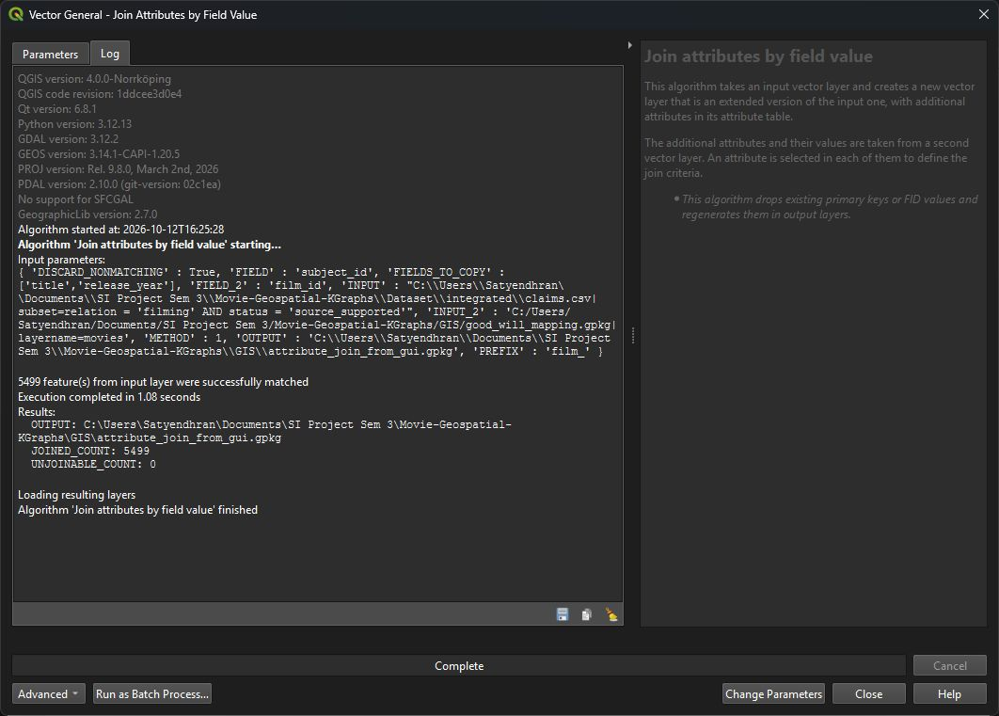
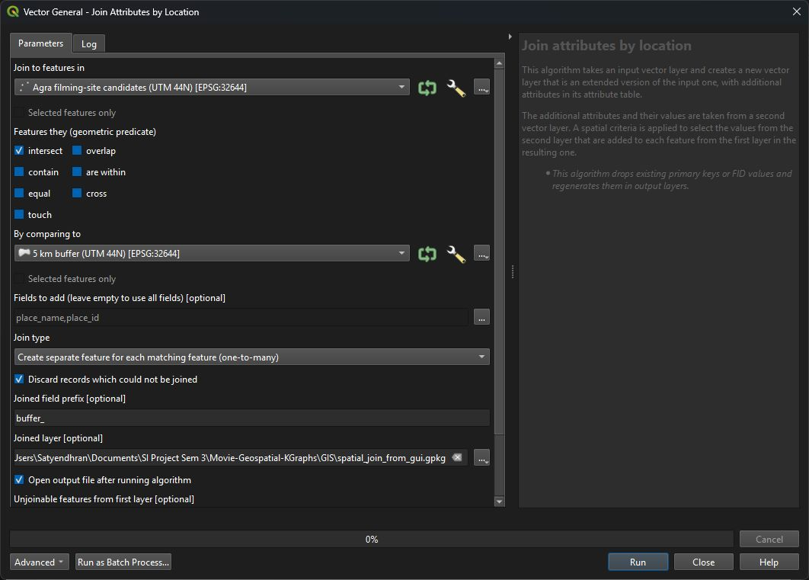
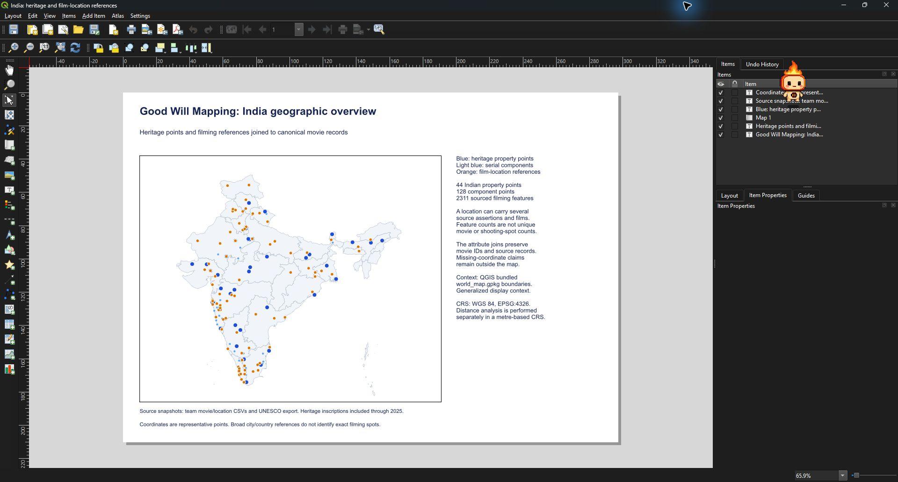

# QGIS screenshots for the mid evaluation

These 10 JPEG files were captured from the running QGIS desktop application on
12 October 2026 while loading the project and executing its processing tools.
They include the actual parameter dialogs and completed logs. They have not
been redrawn or annotated. Some captures contain only the processing dialog;
others show the whole QGIS window.

| Order | Screenshot | What it demonstrates |
|---|---|---|
| 1 | [Project loaded](01_project_loaded.jpg) | The saved project opened in QGIS with its layers and EPSG:32644 |
| 2 | [Agra buffer map](02_agra_buffer_map.jpg) | Agra Fort / Jodhaa Akbar inside the Taj Mahal 5 km buffer |
| 3 | [Joined result attributes](03_joined_result_attributes.jpg) | Movie, place, source row, buffer target and 2,144.978 m distance |
| 4 | [Buffer settings](04_qgis_buffer_settings.jpg) | Projected input, 5,000 metre distance and 72 segments |
| 5 | [Buffer execution](05_qgis_buffer_execution.jpg) | Native QGIS Buffer completion log |
| 6 | [Attribute join settings](06_qgis_attribute_join_settings.jpg) | Assertion `subject_id` joined to canonical movie `film_id` |
| 7 | [Attribute join completed](07_qgis_attribute_join_completed.jpg) | 5,499 matched assertions and zero unjoinable records |
| 8 | [Spatial join settings](08_qgis_spatial_join_settings.jpg) | Local filming-site points intersect the buffer in EPSG:32644 |
| 9 | [Spatial join completed](09_qgis_spatial_join_completed.jpg) | One sourced named-site feature matched the spatial query |
| 10 | [India print layout](10_qgis_india_layout.jpg) | QGIS layout with Indian heritage and filming-reference layers |

[manifest.json](manifest.json) records each filename, caption and UTC capture
time. Window titles reflect the automation's parent window and can differ from
the title of a captured child dialog or layout designer.

The separately saved [Agra map](../agra_5km_map.png) and
[India overview](../india_overview.png) are QGIS print-layout exports suitable
for presentation slides. Open [Good_Will_Mapping.qgz](../Good_Will_Mapping.qgz)
with the adjacent GeoPackage for the live demonstration.

Read [the GIS workflow](../../Docs/GIS_WORKFLOW.md) for the matching keys,
processing steps, interpretation and instructions to repeat the operations.

## Selected captures

## Refreshed graph view — 13 October

[Actual graph explorer screenshot](2026-10-13_03_graph_explorer.jpg).
The original ten screenshots above document the 2000–2025 GUI demonstration;
the refreshed QGIS processing report and maps use 1970–2025.
